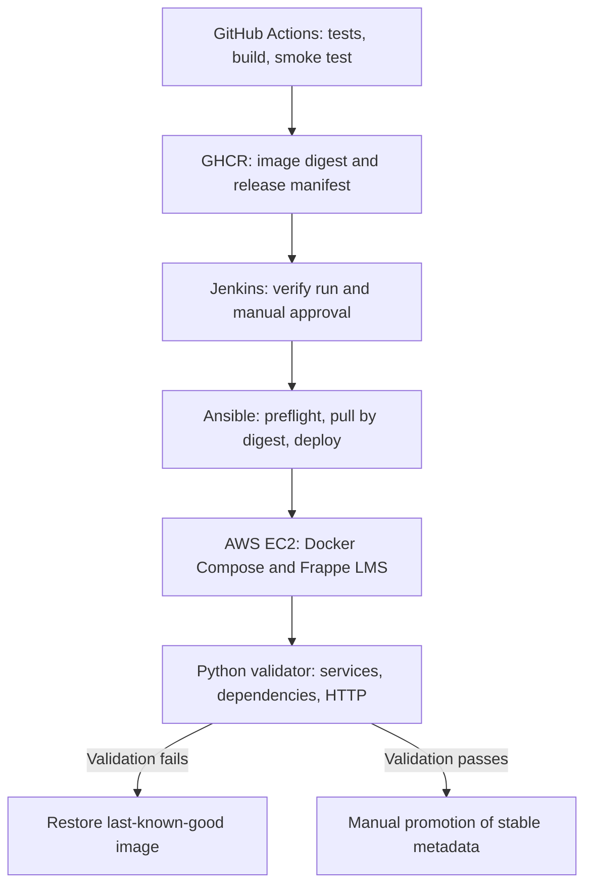

# Frappe LMS DevOps capstone: verified CI/CD on AWS EC2

I used the open source [Frappe Learning (LMS)](https://github.com/frappe/lms) application as the workload for an individual DevOps project. My work in this repository covers CI tests, container image publishing, release verification, a Jenkins approval gate, Ansible deployment, Python validation, and image-only rollback. The LMS application and its original features belong to the upstream Frappe project.

**Portfolio snapshot:** This repository was created from a reviewed source snapshot with a fresh Git history. The operational repository, its GitHub Actions run logs, Jenkins instance, and deployment credentials remain private. This snapshot contains source code for review; it is not a live public demo or a ready-to-run production deployment.

## Release flow

1. [GitHub Actions](.github/workflows/dacn-frappe-tests.yml) runs application tests, builds and smoke tests an image, and publishes a release manifest with the commit, run ID, and immutable GHCR digest.
2. [Jenkins](Jenkinsfile) verifies the run and manifest, executes digest tests, and pauses for a human approval before deployment.
3. [Python](deploy/prepare_cloud_release.py) binds the approved run to the expected image. [Ansible](deploy/cloud/deploy_cloud.yml) checks the existing Cloud state and backup, logs into GHCR using a Jenkins credential, pulls the approved digest, applies its tag, deploys the application services, and removes temporary Docker credentials.
4. The [Cloud validator](deploy/cloud/validate_cloud.py) checks the image ID and digest, six application services, MariaDB, Redis, installed apps, and HTTP. On a failed deployment check, Ansible restores the last-known-good **application image** and validates it. The database is not restored by this image-only rollback.
5. After a successful deployment, a reviewed pull request updates the [stable and target metadata](deploy/cloud/last_known_good_cloud.json). Promotion is manual.

## Technology and implementation

| Area | Stack and work |
| --- | --- |
| Application | Frappe Framework, Frappe LMS, Payments, Vue; additional LMS tests in this project |
| CI and images | GitHub Actions, Python tests, Docker Buildx, GHCR, immutable digest, release manifest |
| Approval and CD | Jenkins Pipeline, human approval, Python manifest verification, Ansible |
| Runtime | AWS EC2, Docker Compose, MariaDB, Redis, six Frappe application services |
| Guardrails | Backup integrity precheck, digest pull, post-deployment Python validation, image-only rollback |

## Observed results from the private deployment

| Check | Recorded result |
| --- | --- |
| GitHub Actions candidate | Run `44930522016` passed tests, build, image smoke test, and manifest publication for commit `b3f715564bab025185dea6fbf65e48665e95236a`. |
| Published image | `ghcr.io/dongocthaonguyen/dacn-frappe-lms@sha256:dc672fce92ad7a8c4107c3991c15a74c4778afd63bd9a4767c6afa6783307bd5` |
| Jenkins deployment | Build `#16` verified the candidate, received manual approval, pulled the digest on EC2, and ended `SUCCESS` with `RELEASE ACCEPTED` (`ok=29`, `failed=0`, `unreachable=0`). |
| Independent EC2 validation | `CLOUD DEPLOYMENT VALIDATION: PASS`; six application services had matching image IDs, MariaDB was healthy, both Redis instances returned PONG, apps `frappe`/`payments`/`lms` were installed, and HTTP returned 200. |
| Stable promotion | A reviewed pull request updated both stable and target image metadata to the validated release. |

The successful build did **not** exercise the rollback path (`rescued=0` in its Ansible recap). Build #15 timed out while awaiting approval and did not deploy. The private operational run logs can be provided for review on request.

## Review the code

- [Application CI and release manifest](.github/workflows/dacn-frappe-tests.yml) · [Docker image build](.github/workflows/dacn-docker-build.yml) · [Jenkins pipeline](Jenkinsfile)
- [Run verification](deploy/read_release_candidate.py) · [approval preparation](deploy/prepare_cloud_release.py) · [digest tests](deploy/test_release_digest.py) · [release preparation tests](deploy/test_prepare_cloud_release.py)
- [Ansible deployment and rollback](deploy/cloud/deploy_cloud.yml) · [EC2 validator](deploy/cloud/validate_cloud.py) · [Cloud deployment notes](deploy/cloud/README_VI.md)

No deployment credentials, EC2 SSH private key, or server runtime environment file are included in this snapshot. The `127.0.0.1` URLs in release metadata are loopback checks executed on the EC2 host. See the upstream [Frappe LMS documentation](https://docs.frappe.io/learning) and this repository's [AGPL-3.0 license](license.txt).
